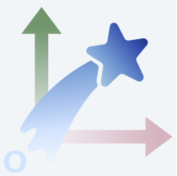
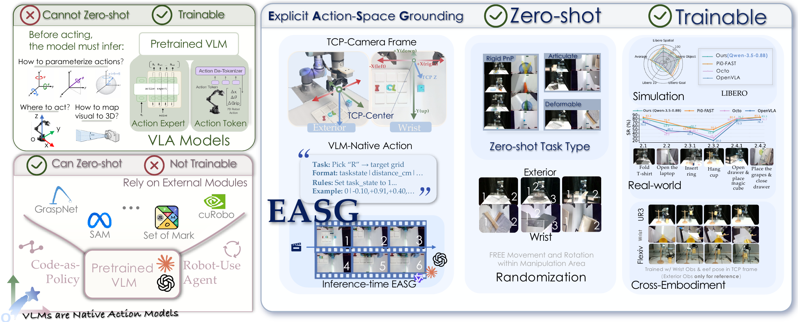
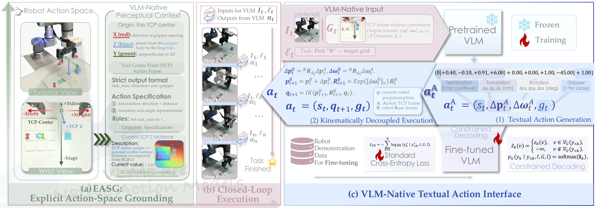

<div align="center">

<h1> VLMs are Native Action Models</h1>

<h3>Unleashing the Manipulation Capabilities of VLMs with Explicit Action-Space Grounding</h3>

<p><a href="https://arxiv.org/abs/2610.12832">Paper</a> | <a href="https://general-robo.github.io/EASG/">Project Page</a> | <a href="https://youtu.be/DsHKnz7V4T4">Video</a> | <a href="https://github.com/General-Robo/EASG">Code</a></p>

<p><a href="https://openreview.net/profile?id=~jingkun_yi1">Jingkun Yi</a><sup>1,2,*</sup> · <a href="https://hishujie.github.io/">Shujie Zhang</a><sup>2,3,*</sup> · <a href="https://openreview.net/profile?id=~Zirui_Zhou6">Zirui Zhou</a><sup>3</sup> · <a href="https://wang-haoxiao.github.io/">Haoxiao Wang</a><sup>1</sup> · <a href="https://openreview.net/profile?id=~Haiyang_Sun6">Haiyang Sun</a><sup>1</sup> · <a href="https://scholar.google.com/citations?user=dttX3KsAAAAJ&amp;hl=zh-CN">Yuhang Dong</a><sup>1</sup> · <a href="https://sheldontsui.github.io/">Xudong Xu</a><sup>2</sup> · <a href="https://xingbaji.github.io/">Xing Shen</a><sup>2</sup> · <a href="https://openreview.net/profile?id=~Tao_Zhang100">Tao Zhang</a><sup>1</sup> · <a href="https://scholar.google.com/citations?hl=en&amp;user=qYcgBbEAAAAJ&amp;view_op=list_works&amp;sortby=pubdate">Yong Liu</a><sup>1</sup> · <a href="https://zhangzjn.github.io/">Jiangning Zhang</a><sup>1,†</sup></p>

<p><sup>1</sup> Zhejiang University · <sup>2</sup> Shanghai Artificial Intelligence Laboratory · <sup>3</sup> Tsinghua University</p>

<p><sup>*</sup> Equal contribution · <sup>†</sup> Corresponding author</p>

<p align="center"> &nbsp;&nbsp;  &nbsp;&nbsp; </p>

</div>

This repository currently provides a simulation implementation of zero-shot robotic manipulation with EASG. It demonstrates the core action-space grounding and closed-loop execution pipeline. The simulation setup, implementation details, and performance may differ from the experiments reported in the paper.

# Overview

  <u>**tl;dr**</u>: We show that <u>**E**xplicit **A**ction-**S**pace **G**rounding</u> enables pretrained VLMs not only to perform <u>zero-shot robotic manipulation</u>, but also to improve through <u>subsequent robot-data fine-tuning</u>.


<p align="center">
  
</p>


Can a pretrained VLM act <u>without additional action tokens</u>, <u>without action heads</u>, and <u>without action pretraining</u>?

EASG (Explicit Action-Space Grounding) projects a Tool Center Point (TCP)-centered action frame into the wrist-camera view and lets the VLM generate executable actions through its native textual interface. The same interface also supports subsequent fine-tuning with robot trajectories.

## Method

<p align="center">
  
</p>

<p align="center">1. <strong>Grounded action space.</strong> 2. <strong>Act with native text.</strong> 3.<strong>VLM-Native Fine-tuning.</strong></p>

# TODO

- [ ] Support robot-trajectory fine-tuning using the same TCP-centered textual action interface as zero-shot execution. Fine-tuned models will use the same action representation and execution pipeline.

# Usage

Run the commands below in **Bash on Linux**, from the EASG project root:

```bash
git clone https://github.com/General-Robo/EASG
cd /path/to/EASG
```

## 1. Set up the environment

Use **Isaac Sim 5.1.0 with Python 3.11**. Choose **one** of the following two setup paths.

An RTX-capable NVIDIA GPU and a compatible driver are required, including in headless mode. Check the [Isaac Sim hardware requirements](https://docs.isaacsim.omniverse.nvidia.com/5.1.0/installation/requirements.html) before installation.

```bash
nvidia-smi
```

### Option A: Fresh installation with Conda and pip

With Conda installed, create a dedicated environment and install Isaac Sim. On Linux, the pip installation requires GLIBC 2.35 or newer (`ldd --version`). These commands follow the [Isaac Sim 5.1 Python installation guide](https://docs.isaacsim.omniverse.nvidia.com/5.1.0/installation/install_python.html).

```bash
conda create -n easg python=3.11 pip -y
conda activate easg

python -m pip install --upgrade pip
python -m pip install 'isaacsim[all,extscache]==5.1.0' \
  --extra-index-url https://pypi.nvidia.com

export EASG_PYTHON=python
```

The version is pinned for project compatibility; Other Isaac Sim versions have not been validated for this project.

### Option B: Reuse an existing standalone Isaac Sim installation

If Isaac Sim **5.1.0** is already installed, use its bundled Python through `python.sh`. Start in a terminal without an active Conda environment.

```bash
# Replace this with the absolute path to your existing installation.
export EASG_PYTHON=/path/to/isaac-sim/python.sh

"$EASG_PYTHON" -c 'import sys; print(sys.executable); print(sys.version)'
```

Use the installation's `python.sh`, not its internal Python binary, so its runtime paths are configured. Additional packages must be installed through the same launcher. See the [bundled Python instructions](https://docs.isaacsim.omniverse.nvidia.com/5.1.0/installation/install_python.html#default-python-environment).

The project-root `./python.sh`, if present, is a machine-specific convenience wrapper and may point to a different installation. The commands here do not depend on it.

### Finish setup for either option

After reading and accepting the [NVIDIA Omniverse license agreement](https://docs.omniverse.nvidia.com/platform/latest/common/NVIDIA_Omniverse_License_Agreement.html), set:

```bash
export OMNI_KIT_ACCEPT_EULA=YES
export PYTHONNOUSERSITE=1
unset PYTHONHOME PYTHONPATH
```

After completing either setup option, install the project dependencies from [requirements.txt](requirements.txt) using the selected Python environment:

```bash
"$EASG_PYTHON" -m pip install -r requirements.txt

"$EASG_PYTHON" -c 'import numpy, PIL, requests, imageio, imageio_ffmpeg; print("Dependencies OK"); print(imageio_ffmpeg.get_ffmpeg_exe())'
```

The requirements pin NumPy to `1.26.0`, matching Isaac Sim 5.1.0's package requirement. Packages already installed at the required versions are reused; missing or mismatched packages are installed or adjusted. With Option B, this command operates on the standalone installation's Python environment.

In each new terminal, activate `easg` for Option A or select the standalone launcher for Option B, then set `EASG_PYTHON` and the environment variables above again. Installation is only needed once. All remaining commands use `"$EASG_PYTHON"` for either setup.

## 2. Check the scene without calling a model

```bash
"$EASG_PYTHON" script/run.py --task pick_place --headless --observe-only \
  --output output/observe_pick_place
```

This prepares the scene and captures one observation without an API key or model request. Inspect the following files in `output/observe_pick_place/step_001/`:

- `external.png`: external camera view.
- `wrist.png`: raw wrist camera view.
- `wrist_tcp.png`: wrist view with the TCP coordinate overlay.
- `prompt.txt` and `observation.json`: generated prompt and observation data.

The first launch may take longer while extensions and rendering caches initialize. Remove `--headless` to open the simulator window if a desktop display is available. An observation-only run does not execute the task, so `success: false` is expected.

## 3. Configure the API key

Set your OpenRouter API key (replace the placeholder with your own key):

```bash
export OPENROUTER_API_KEY="YOUR_OPENROUTER_API_KEY"
```

Alternatively, pass `--keys-file /path/to/private/openrouter_keys.json`. The file must contain a JSON list with exactly one key:

```json
["YOUR_OPENROUTER_API_KEY"]
```

Keep the file outside the repository with permission `600`. An explicit `--keys-file` takes precedence over the environment variable. 

Online runs send images and prompts to the model service and incur API charges. Ensure the key has sufficient credit and access to the selected model.

## 4. Run a task

### Pick and place

Pick up a banana and place it on the plate:

```bash
"$EASG_PYTHON" script/run.py --task pick_place --headless 
```

To change the grasped object or output path:

```bash
"$EASG_PYTHON" script/run.py --task pick_place --headless --object cucumber --output output/cucumber_run01
```

Supported objects: `banana`, `cucumber`, `carrot`.

Based on our testing, the success rate is around 55%, so you may need to run it a few times before getting a successful result. 

### Randomized object and target positions

**Position randomization is supported for pick-and-place tasks and is disabled by default.** Enable it to test different initial layouts: both the grasped object and the placement target are randomized in XY on the workmat. Initial orientations, scales, camera poses, lighting, and materials remain unchanged.

```bash
"$EASG_PYTHON" script/run.py --task pick_place --headless \
  --position-randomization --position-seed 42
```

Omit `--position-seed` to generate a new seed automatically. With the same object, target, and scene configuration, a fixed seed reproduces the sampled initial layout, not necessarily the model responses or task outcome. The sampler keeps both footprints at least 5 cm from the workmat edge and at least 3 cm apart.

The seed and randomization settings are saved in `run_config.json`; sampled and settled placements are recorded in `position_layout.json`. Use `--no-position-randomization` (or omit the randomization flag) for the fixed default layout.

### Change run settings

For example, use GPU 1, a different prompt, `high` reasoning, and at most 50 actions:

```bash
"$EASG_PYTHON" script/run.py --task pick_place --headless \
  --object carrot --target plate_white \
  --gpu 1 \
  --prompt-template script/prompt/prompt.txt \
  --reasoning-effort high --max-task-steps 50 \
  --output output/carrot_custom_run01
```

TCP Z distances are measured independently on the positive and negative half-axes. Each available side is drawn to its nearest observed surface sample; unavailable sides are omitted. Custom prompts should describe these signed distances.

| Option | Default / usage |
| --- | --- |
| `--instruction` | Override task text; does not change the scene or success evaluator |
| `--model` | `qwen/qwen3.8-27b`; availability depends on the provider |
| `--reasoning-effort` | `xhigh`; must be supported by the selected model |
| `--max-task-steps` | `65`; maximum action turns, not simulation frames |
| `--chat-connection-mode` | `continuous`; also supports `separate` and `first-recent` |
| `--chat-recent-turns` | `2`; used by `first-recent` |
| `--gpu` | `0`; select an available GPU index |
| `--position-randomization` | Off by default; randomize object and target XY positions for pick-and-place tasks |
| `--position-seed` | Requires `--position-randomization`; generated and saved when omitted; set explicitly to reproduce the sampled layout |


### Conversation history modes

`--chat-connection-mode` controls how much previous conversation history is included in each VLM request. A completed turn contains the observation prompt, its images, and the model's action reply. Every mode includes the current observation and instructions.

| Mode | Context sent to the VLM |
| --- | --- |
| `continuous` (default) | All previous turns plus the current observation. Context grows with the number of steps. |
| `separate` | Only the current observation and instructions, with no previous images or action replies. The simulation state continues normally; the scene and robot are not reset. |
| `first-recent` | The first completed turn and the latest N completed turns, plus the current observation. Overlapping turns are included only once. N is set by `--chat-recent-turns` (default: `2`). |

For example, when requesting **step 10** with `--chat-recent-turns 2`:

- `continuous`: history from steps 1–9 + the current observation at step 10.
- `separate`: only the current observation at step 10.
- `first-recent`: history from steps 1, 8, and 9 + the current observation at step 10.

In `first-recent` mode, messages explicitly label historical steps and the current step to help prevent old images from being mistaken for the current state.

For the full list of options:

```bash
"$EASG_PYTHON" script/run.py --help
```

## 5. View results and replay

Open the output directory after a run:

- `execution.mp4`: task recording.
- `result.json`: final physical evaluation; check `success` rather than only the model's completion claim.
- `run_config.json` and `physics_config.json`: saved run settings.
- `position_layout.json`: sampled and settled object/target placements when position randomization is enabled.
- `step_XXX/`: observations, prompts, model responses, actions, and per-step evaluation.
- `api_usage.json`: recorded API usage for online execution.


# Citation

If you find EASG useful, please consider citing:

```bibtex
@misc{yi2026vlmsnativeactionmodels,
  title={VLMs are Native Action Models: Unleashing the Manipulation Capabilities of VLMs with Explicit Action-Space Grounding},
  author={Jingkun Yi and Shujie Zhang and Zirui Zhou and Haoxiao Wang and Haiyang Sun and Yuhang Dong and Xudong Xu and Xing Shen and Tao Zhang and Yong Liu and Jiangning Zhang},
  year={2026},
  eprint={2610.12832},
  archivePrefix={arXiv},
  primaryClass={cs.RO},
  url={https://arxiv.org/abs/2610.12832}
}
```
